# Reusable High-Altitude Radiation Measurement System

B.S. Physics Thesis — Middle East Technical University (METU), İVMER 
Supervisor: Prof. Dr. M. Bilge Demirköz · 2022 – 2024 
Funded by TÜBİTAK 2209-A (Project No. 1919B012212231) · Flown with the Turkish State Meteorological Service (TSMS)

A reusable stratospheric balloon payload that measures cosmic-ray dose rate as a function of altitude, aimed at observing the Regener–Pfotzer maximum. I designed the payload's embedded hardware and firmware and the ground station, flew it on a meteorological balloon to ~33 km, and recovered it 147 km from the launch site.

> This repository is a project showcase. Design files and firmware are not published; the thesis and poster are.

  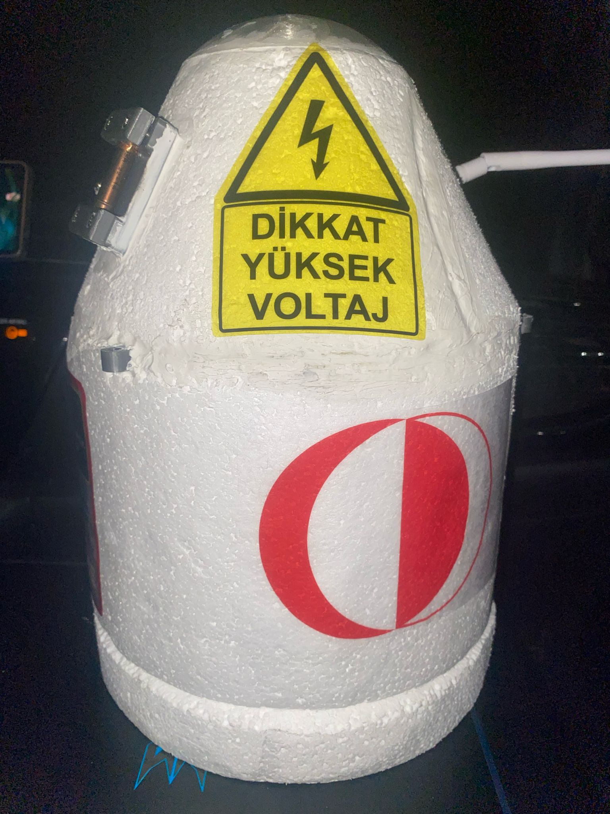
  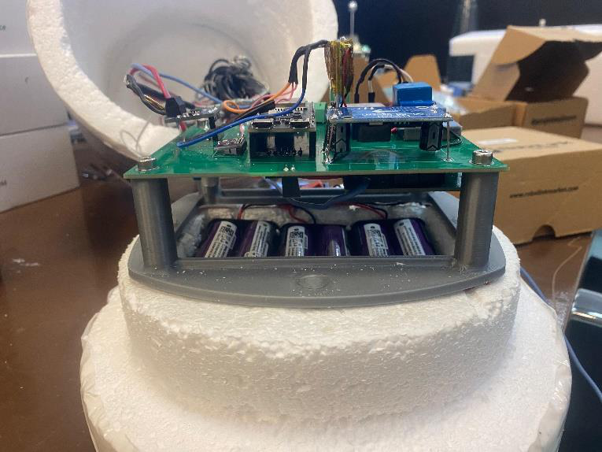

## Highlights

| | |
|---|---|
| Maximum altitude | ~33 km (barometric), full ascent and descent profile recorded |
| Radiation data | Geiger counts up to ~20 km; dose-rate profile agrees with the CARI-7A model |
| Telemetry range | 180 km LoRa link, 83 % packets received at maximum range |
| Recovery | GPRS position SMS every minute after landing; payload recovered from a tree 147 km away |
| Thermal | Inside stayed above −25 °C while outside reached −50 °C; cold-tested at −72 °C (dry ice) |
| Mass | 1100 g payload (TSMS limit), EPS case with conical nose, 2 m parachute (≈3.5 m/s descent) |

## Results

### Dose rate vs. altitude

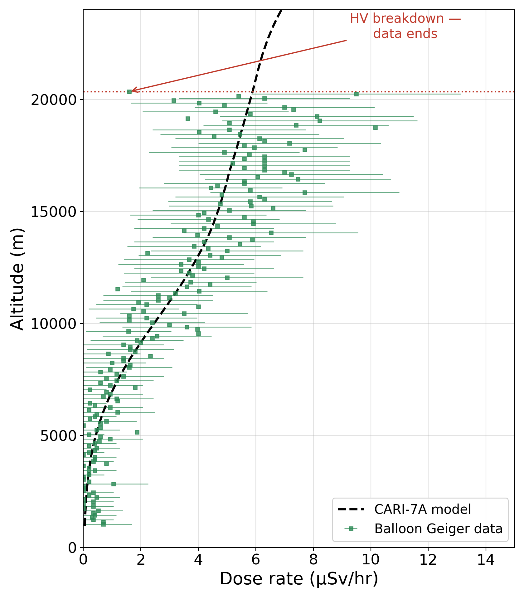

The measured dose rate rises with altitude and follows the CARI-7A model up to ~20 km, where the Geiger counts approach the Regener–Pfotzer maximum.

### Failure analysis — high-voltage breakdown at low pressure

At ~20 km the Geiger data stopped. Post-flight analysis traced it to Paschen breakdown: the breakdown voltage of air falls sharply at low pressure, and the 1.4 mm lead spacing of a transistor in the high-voltage stage was no longer enough to prevent an arc. The arc destroyed the transistor; after replacing it, the circuit worked again. The fix for the next flight is conformal coating of the HV section and larger creepage distances.

### Flight profile and environment

  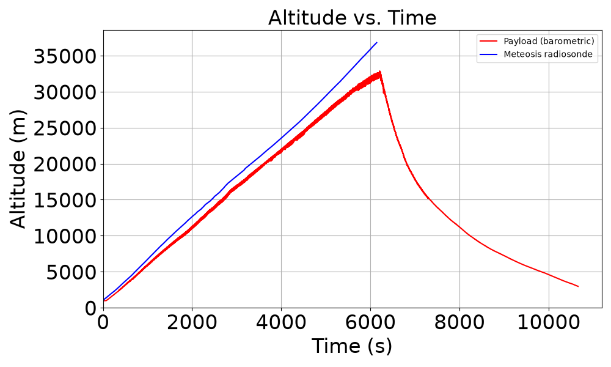
  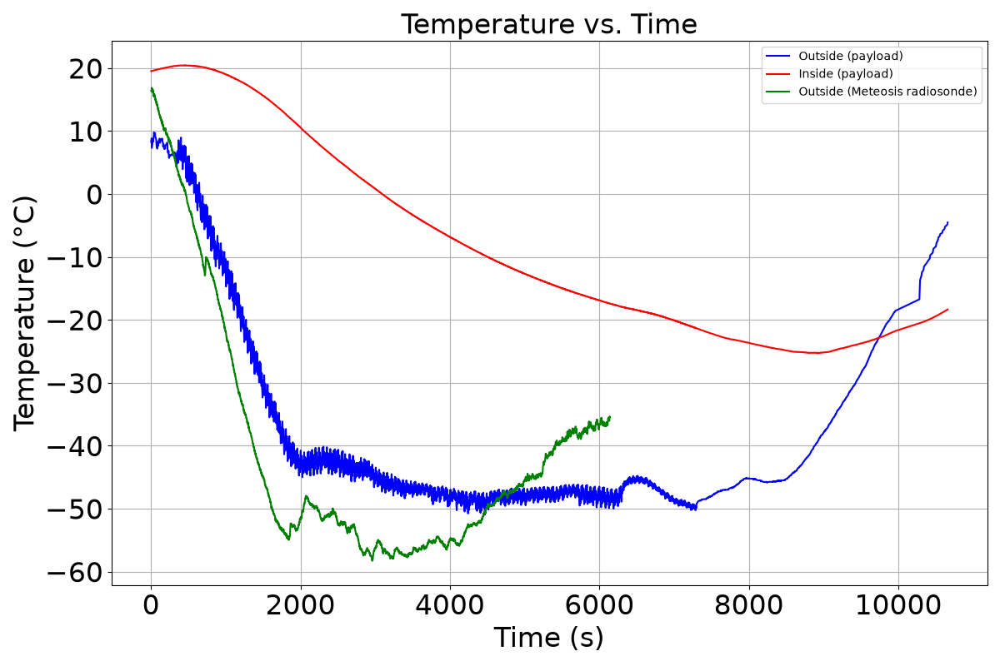

- Barometric altitude tracks the co-flown Meteosis radiosonde during ascent. Unlike the radiosonde, the payload also logged the full descent.
- Outside temperature matches the radiosonde; the insulated case and SD-card heater kept the electronics far warmer than ambient.

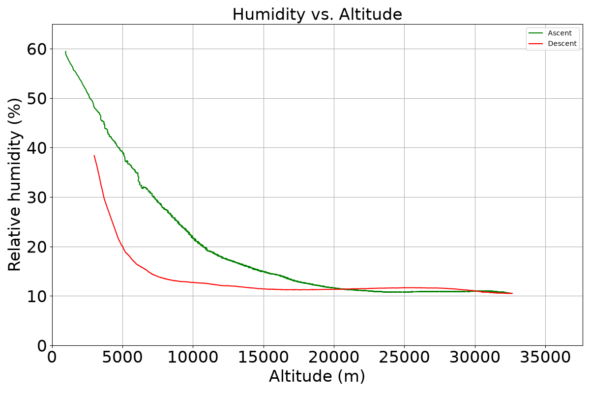

## System architecture

### Flight payload

| Block | Implementation |
|---|---|
| Detector | Geiger–Müller tube with high-voltage bias, pulse read-out and counter (İVMER İvmeRad design, integrated by me) |
| Controller | ESP32-S3 |
| Sensors | Honeywell SSC & BME280 pressure, humidity, MPU6050 IMU, GNSS, K-type thermocouple (outside), DS18B20 |
| Altitude estimation | Barometric formula + linear Kalman filter |
| Telemetry | LoRa SX1276 (868 MHz), omnidirectional antenna |
| Recovery | GPRS module (SMS with position), buzzer and LED |
| Data logging | SD card with relay-controlled heater |
| Power | 6 × 3200 mAh Li-ion (2S3P) |

### Ground station

ESP32 + LoRa SX1276 receiver, SD logging, directional high-gain antenna, custom PCB and enclosure.

  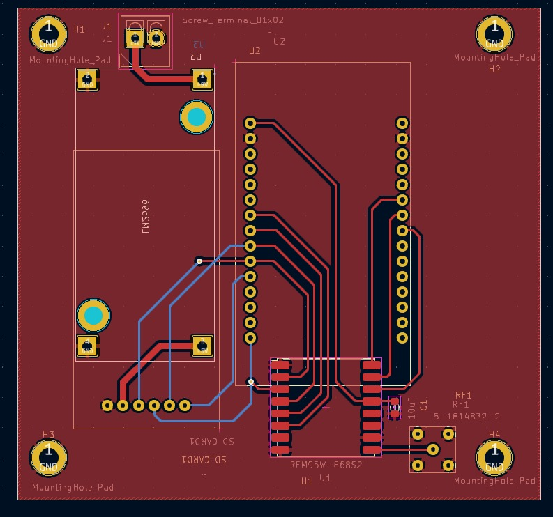
  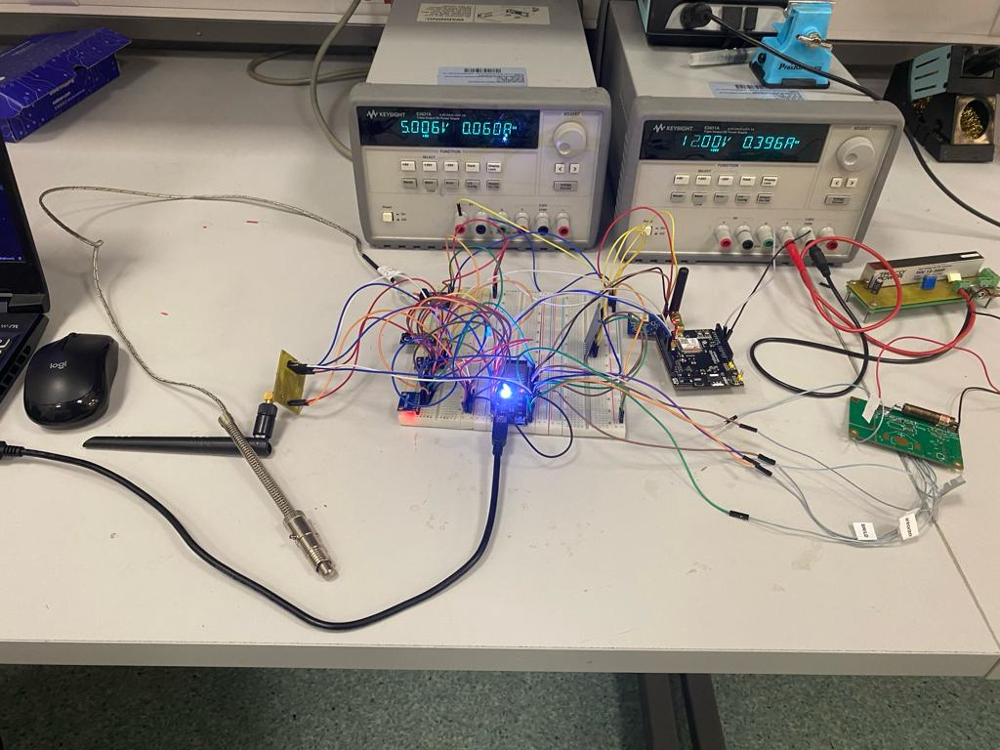

## Testing and recovery

  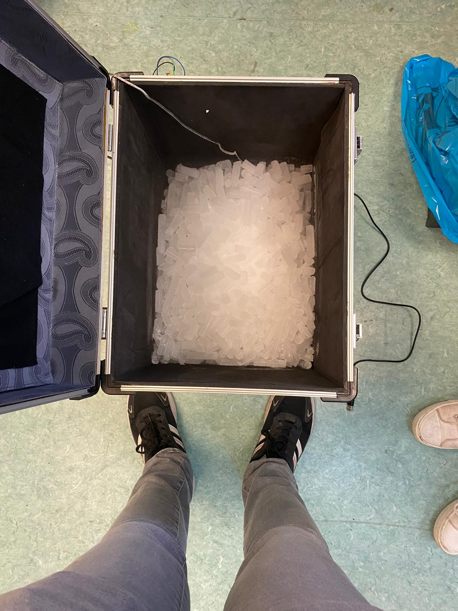
  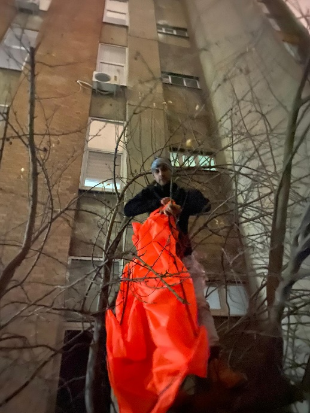
  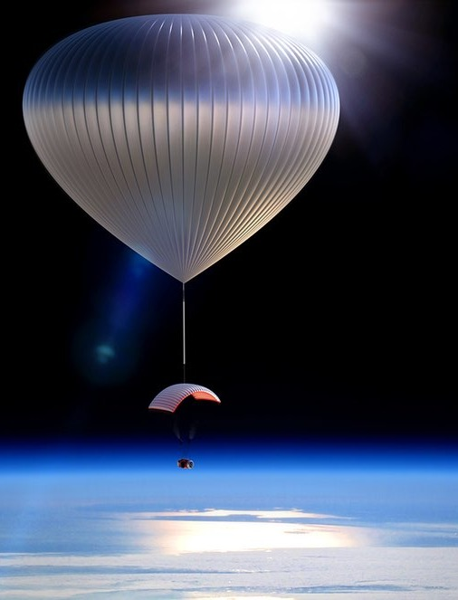

- Bench bring-up of every subsystem, drop testing, and cold testing down to −72 °C with solid CO₂
- After landing, the GPRS module sent one position message per minute — from the top of a tree 147 km from the launch site

## My contribution

I was responsible for the embedded hardware and software of the payload and ground station:

- Designed the payload flight card and the ground-station board: schematic capture, 4-layer PCB design, fabrication and assembly
- Integrated the İVMER Geiger–Müller read-out, high-voltage and counter circuits with the ESP32-S3 flight computer
- Wrote the flight and ground-station firmware: sensor drivers, LoRa/GPRS telemetry, Kalman altitude estimation, SD logging, heater control
- Ran the environmental tests, processed and plotted the flight data in Python, and performed the post-flight failure analysis

## Documents

- 📄 [B.S. Thesis — Final Report](docs/thesis.pdf)
- 🖼️ [Poster](posters/poster.pdf)

### Publications

- *Design of a Reusable Radiation Measurement System Integrated with the High-Altitude Balloon*, Ankara International Aerospace Conference (AIAC 2023) Proceedings, METU
- *Design of a Reusable Radiation Measurement System Integrated with the High-Altitude Balloon*, ATMOS 2024 — Atmospheric Science Conference, Abstract Book, p. 354

## Skills demonstrated

`Radiation detection` · `High-voltage integration` · `Multi-layer PCB (KiCad)` · `ESP32` · `LoRa / GPRS telemetry` · `Kalman filtering` · `Environmental testing` · `Failure analysis` · `Python (NumPy, Matplotlib)`
